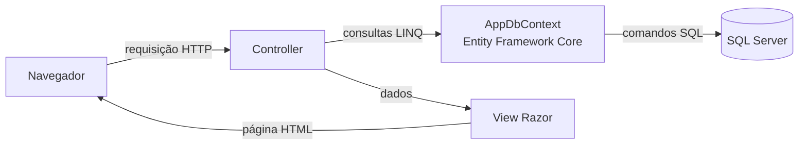
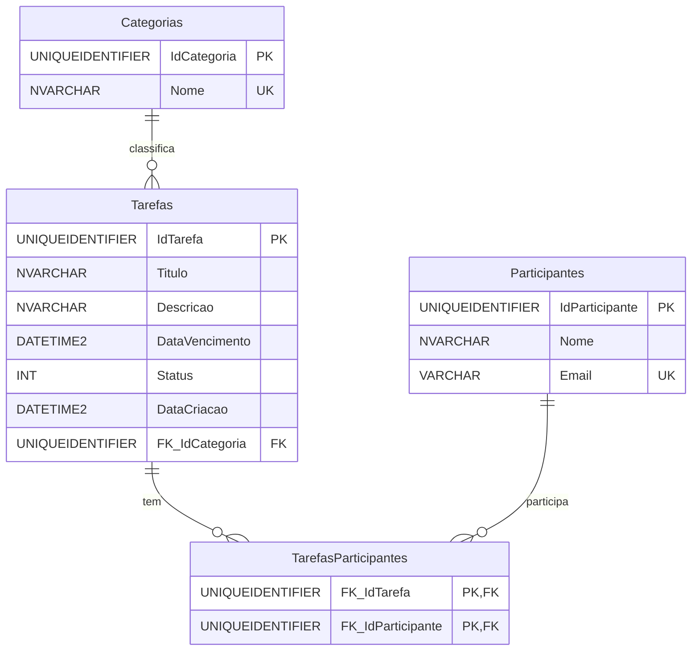

# Gerenciador de Tarefas

Aplicação web para organizar e acompanhar tarefas, desenvolvida como projeto de portfólio para praticar e demonstrar desenvolvimento full stack com **C#**, **ASP.NET Core MVC**, **Entity Framework Core** e **SQL Server**.

Cada tarefa tem título, descrição, data de vencimento, status, categoria e uma lista de participantes (que pode ficar vazia).

## Tecnologias

- C#
- ASP.NET Core MVC (.NET 10)
- Entity Framework Core (SQL Server)
- SQL Server e SQL Server Management Studio (SSMS)
- Bootstrap
- Git e GitHub

## Funcionalidades

- CRUD completo de tarefas: cadastrar, listar, visualizar, editar e excluir.
- Cada tarefa pertence a uma categoria e pode ter vários participantes, ou nenhum.
- Cadastro rápido de participante direto no formulário da tarefa, sem sair da página.
- Filtros na lista de tarefas por participante, categoria e status.
- Cadastro de categorias e de participantes, com nome de categoria e e-mail únicos.
- Bloqueio da exclusão de categorias que ainda tenham tarefas.
- Controle de status: pendente, em andamento ou concluída.
- Banco de dados criado automaticamente na primeira execução, já com dados iniciais.
- Página **Sobre o projeto** (`/sobre`) com a explicação do sistema e o modelo relacional.

## Arquitetura

Aplicação web monolítica no padrão **MVC** (Model-View-Controller). Para manter o projeto simples, não há camadas extras de serviço ou repositório: os controllers usam o `AppDbContext` do Entity Framework diretamente.



- **Controllers:** recebem a requisição, validam os dados, leem e gravam pelo `AppDbContext` e escolhem a view.
- **Models:** entidades `Tarefa`, `Categoria` e `Participante`, com as validações dos formulários.
- **Views:** páginas Razor com Bootstrap. Um pequeno JavaScript cuida do cadastro rápido de participantes no formulário da tarefa.
- **Data e Migrations:** o `AppDbContext` mapeia as entidades para as tabelas, e as migrations versionam o banco. Elas são aplicadas automaticamente quando a aplicação inicia.
- **Regras de negócio em dois níveis:** validação nos controllers e models, com mensagens amigáveis, e constraints no banco (chaves, `CHECK`, índices únicos), que garantem as regras mesmo fora da aplicação.

## Como executar

**Pré-requisitos**

- [.NET 10 SDK](https://dotnet.microsoft.com/download)
- SQL Server LocalDB (já vem instalado com o Visual Studio)

**Passos**

```bash
git clone <url-do-repositório>
cd GerenciadorTarefas
dotnet run
```

Acesse `http://localhost:5062`.

Na primeira execução, a aplicação cria o banco `GerenciadorTarefas` no LocalDB e aplica as migrations, cadastrando categorias e participantes de exemplo. Não é preciso rodar nenhum script.

> Para usar outra instância do SQL Server, altere a connection string `DefaultConnection` em `appsettings.json`.

## Modelo relacional



- **Categorias → Tarefas (1:N):** cada tarefa pertence a exatamente uma categoria.
- **Tarefas ↔ Participantes (N:N):** uma tarefa pode ter vários participantes ou nenhum, e um participante pode estar em várias tarefas. A ligação fica na tabela associativa `TarefasParticipantes`.
- `Status` é um enum em C#: `0 = Pendente`, `1 = EmAndamento`, `2 = Concluida`, garantido no banco pela constraint `CK_Tarefas_Status`.
- E-mail de participante e nome de categoria são únicos.
- Não é possível excluir uma categoria que ainda tenha tarefas.
- Ao excluir uma tarefa ou um participante, os vínculos entre eles são apagados juntos (`ON DELETE CASCADE`).

## Scripts SQL

A pasta [`database/`](database) contém scripts para criar e consultar o mesmo banco manualmente pelo SSMS, sem depender do Entity Framework:

| Arquivo | Conteúdo |
| --- | --- |
| `01_create_database.sql` | Criação do banco `GerenciadorTarefas` |
| `02_create_tables.sql` | Tabelas, chaves primárias, chaves estrangeiras e constraints |
| `03_insert_data.sql` | Categorias, participantes, tarefas e vínculos de exemplo |
| `04_consultas.sql` | Consultas com `WHERE`, `ORDER BY`, `INNER JOIN`, `LEFT JOIN`, `NOT IN` e `GROUP BY` |
| `05_views.sql` | Views `vw_Tarefas`, `vw_TarefasParticipantes` e `vw_TarefasAtrasadas` |
| `06_procedures.sql` | Procedures `sp_InserirTarefa`, `sp_AdicionarParticipante`, `sp_AtualizarStatus` e `sp_ListarTarefasPorParticipante` |
| `07_indexes.sql` | Índices únicos e índices das chaves estrangeiras |

Execute os arquivos na ordem numérica. Use os scripts **ou** a aplicação (`dotnet run`) para criar o banco, não os dois no mesmo banco.

## Estrutura do projeto

```
├── Controllers/   # Recebem as requisições e coordenam as operações
├── Data/          # AppDbContext: mapeamento, relacionamentos e dados iniciais
├── Migrations/    # Histórico do esquema gerado pelo Entity Framework
├── Models/        # Entidades Tarefa, Categoria, Participante e enum EStatus
├── Views/         # Páginas Razor com Bootstrap
├── database/      # Scripts SQL para o SSMS
└── wwwroot/       # Arquivos estáticos (CSS, JS, bibliotecas)
```

## Autor

Desenvolvido por Rafael Vassis.
